<div align="center">
  <h1>Entry Blackout Estimation</h1>
  <p><strong>Production-grade multi-sensor fusion for spacecraft re-entry navigation through plasma blackout</strong></p>

  <p>
    <a href="https://www.rust-lang.org/"></a>
    <a href="#"></a>
    <a href="#"></a>
  </p>

  <p>
    <a href="README_CN.md">中文文档</a>
  </p>
</div>
<p align="center">
  <a href="#1-installation">Installation</a> •
  <a href="#2-quick-start">Quick Start</a> •
  <a href="#3-core-concepts">Core Concepts</a> •
  <a href="#4-architecture">Architecture</a> •
  <a href="#5-data--evaluation">Data</a> •
  <a href="#6-extensibility">Extensibility</a> •
  <a href="#7-development">Development</a> •
  <a href="#8-code-structure">Code Structure</a> •
  <a href="#9-references">References</a>
</p>

---

## Overview

When a spacecraft re-enters Earth's atmosphere, the extreme heat generates a **plasma sheath** that completely blocks GNSS signals for ~40 seconds. During this **blackout window**, navigation relies solely on IMU dead-reckoning, which drifts rapidly. The estimator must restore accurate state estimates within a **tight 2-second window** after blackout ends—or risk losing control.

**Application scenarios:**
- Reusable launch vehicles (booster recovery)
- Crewed capsule return (Crew Dragon, Shenzhou)
- Planetary sample return missions (Mars/Moon)

```mermaid
gantt
    title Re-entry Mission Timeline
    dateFormat s
    axisFormat %S s
    section Sensors
    GNSS Available     :done, gnss1, 0, 120
    GNSS Blackout      :crit, blackout, 120, 160
    GNSS Recovery      :done, gnss2, 160, 180
    section Estimation
    Normal Fusion      :done, fuse1, 0, 120
    IMU Dead-Reckoning :crit, imu, 120, 160
    2s Recovery Window :milestone, recovery, 162, 0
```



**Key challenges:**
- **Asynchronous multi-rate sensors**: IMU (400 Hz), GNSS (10 Hz), star tracker (4 Hz), radar altimeter (50 Hz)
- **Delayed/out-of-order measurements**: star tracker and radar have fixed latencies
- **Observation degeneracy**: no GNSS during blackout; partial observability only
- **Non-ideal measurements**: dropouts, outliers, geometric degeneracy
- **Statistical consistency**: filter must satisfy NEES/NIS bounds, not just accuracy

**This repository implements:**
- **Square-root error-state EKF** for numerical stability and proper quaternion handling
- **Fixed-lag RTS smoothing** to improve blackout-phase estimates using post-blackout information
- **Rewind-replay time alignment** for delayed measurements
- **Tight coupling** (optional): fuse raw pseudorange + Doppler for improved velocity capture
- **Robust gating and outlier rejection**

## Results

| Mode | Monte Carlo (500 runs) | Pass Rate |
|------|------------------------|-----------|
| Tight | `TIGHT=1 harness 500` | **100.0%** (500/500) |
| PVT | `harness 500` | **97.0%** (485/500) |

Full mission specification and acceptance criteria: see [`tasks.md`](tasks.md).


---

## 1. Installation

Prerequisites:

- Rust (stable) + Cargo

Build (diagnostics-enabled by default):

```bash
cargo build --release
```

Feature flags:

- `default = ["diagnostics"]` enables sim + plotting tools.
- `--no-default-features --features flight` builds a minimal library without sim/plot code.
- Tight coupling (`update_gps_raw{,_ref}`) is part of the **core estimator** and is available in `flight` builds.

---

## 2. Quick Start

### Run the Monte Carlo harness

PVT mode (default):

```bash
cargo run --release --bin harness -- 500
```

Tight-coupled GNSS (raw pseudorange + Doppler):

```bash
TIGHT=1 cargo run --release --bin harness -- 500
```

The harness writes:

- `mc_summary_{pvt|tight}.csv` (per-run metrics + pass flag)
- `mc_nees_blocks_{pvt|tight}.csv` (NEES by state block)
- `mc_nees_phase_{pvt|tight}.csv` (NEES/NIS by phase: pre/blackout/post/tail)
- `mc_post_window_{pvt|tight}.csv` (post-blackout GNSS stats)
- `mc_*.svg` plots for histograms and coverage curves

### Reproduce a single seed

```bash
cargo run --release --bin repro -- 231
TIGHT=1 cargo run --release --bin repro -- 231
```

Debug traces (only when needed):

```bash
TRACE=1 cargo run --release --bin repro -- 206
TRACE_GNSS=1 TIGHT=1 cargo run --release --bin repro -- 231
```

---

## 3. Core Concepts

### The mission window

The evaluator computes RMS errors **only** in the post-blackout recovery window:

- `t ∈ [blackout_end, blackout_end + 2 s]` (default: `[160 s, 162 s]`)

Passing criteria (see `tasks.md` for full wording; code uses 1σ equivalents):

- `rms_pos <= 40/3 m`
- `rms_vel <= 0.5/3 m/s`
- `rms_att <= 0.05 deg`
- `gyro bias RMS <= 0.005 deg/s`
- `accel bias RMS <= 120 µg`

### NEES vs NIS

- **NIS** checks the measurement side (innovation vs `R`).
- **NEES** checks global consistency (state error vs `P`).

This repo reports both overall and decomposed views:

- by **state block** (`r`, `v`, `ba`)
- by **phase** (pre / blackout / post / tail)

### Time alignment (delays / out-of-order)

Star tracker and radar measurements are **delayed** in the task spec. This repo handles delayed / out-of-order measurements via **rewind-to-measurement-time + deterministic replay** over a fixed horizon buffer:

- restore the closest snapshot **≤ t_meas**,
- replay logged IMU/measurement events up to `t_meas`,
- apply the update at `t_meas`,
- replay the remaining events back to “now”.

This keeps state/covariance updates time-consistent (no “approximate innovation at current time” hacks).

### Tight vs PVT

- **PVT**: update directly with `pos/vel` measurements.
- **Tight**: update with raw **pseudorange + Doppler**, which:
  - improves velocity capture in the post-blackout window,
  - provides stronger bias observability when geometry is favorable,
  - requires explicit handling of Doppler **geometry degeneracy** to avoid injecting noise in weak directions.

---

## 4. Architecture

Core modules live in `src/`:

| Module | Purpose |
| --- | --- |
| `src/estimator.rs` | SR-EKF time update (QR), measurement updates (GNSS/Star/Radar), tight raw update, **rewind/replay time alignment**, bias pre-calibration, history buffer + RTS smoothing |
| `src/sim.rs` | Truth + sensor simulation, dropout/outlier injection, blackout phases, Monte Carlo metrics and pass criteria |
| `src/physics.rs` | Aerodynamic force/torque model interface used by truth and filter |
| `src/data.rs` | Loads vehicle properties / aero tables / RCS series from `data/` |
| `src/plot.rs` | Writes CSVs and SVG plots for harness outputs |
| `src/types.rs` | State, noise, and parameter definitions (`NoiseParams`, `STATE_DIM`, etc.) |
| `src/util.rs` | Small numeric utilities (SPD enforcement, helpers) |

CLI entry points:

- `src/bin/harness.rs`: Monte Carlo harness + plots/CSVs
- `src/bin/repro.rs`: single-seed reproduction
- `src/bin/sweep.rs`: parameter sweeps (offline tuning)
- `src/bin/microbench.rs`: hot-path microbenchmarks

Design + interface notes:

- `docs/design.md`
- `docs/interface.md`
- `docs/verification.md`

---

## 5. Data & Evaluation

Input data (CSV) lives in `data/` and is loaded at runtime:

- `data/Vehicle Properties Preview.csv`
- `data/Aero Coeff Table.csv`
- `data/RCS Torque Series 100Hz Preview.csv`

Outputs are regenerated on each harness run (see section 2).

---

## 6. Extensibility

Typical extensions:

- Add a new sensor: implement an update in `src/estimator.rs` and inject events in `src/sim.rs`.
- Add/retune process noise: extend `NoiseParams` in `src/types.rs` and wire into `process_noise()`.
- Swap tight coupling models: edit `update_gps_raw_ref()` measurement model / gating / robustification.
- Build “on-board style” library: `--no-default-features --features flight` (no sim/plot bins).

---

## 7. Development

Run tests:

```bash
cargo test
```

Optional (recommended) checks:

```bash
cargo fmt
cargo clippy --all-targets -- -D warnings
```

---

## 8. Code Structure

```text
src/
  estimator/       # SR-EKF, measurement updates, RTS smoothing, time alignment
  sim/             # Truth simulation, Monte Carlo harness, metrics
  bin/             # CLI tools: harness, repro, sweep, microbench
  types.rs         # State, NoiseParams, DynamicsParams
  physics.rs       # Aero force/torque model
  data.rs          # Vehicle/aero data loaders
data/              # CSV input files
docs/              # design.md, interface.md, verification.md
```

---

## 9. References

- `tasks.md` — SE-2317 mission statement, targets, and evaluation criteria.
- Groves, *Principles of GNSS, Inertial, and Multisensor Integrated Navigation Systems*.
- Standard EKF consistency diagnostics: NEES/NIS (χ² coverage, phase/block decomposition).
