<div align="center">
  <h1>再入黑障状态估计</h1>
  <p><strong>面向航天器再入等离子黑障的生产级多传感器融合导航</strong></p>

  <p>
    <a href="https://www.rust-lang.org/"></a>
    <a href="#"></a>
    <a href="#"></a>
  </p>

  <p>
    <a href="README.md">English</a>
  </p>
</div>

<p align="center">
  <a href="#1-安装">安装</a> •
  <a href="#2-快速开始">快速开始</a> •
  <a href="#3-核心概念">核心概念</a> •
  <a href="#4-架构">架构</a> •
  <a href="#5-数据与评测">数据</a> •
  <a href="#6-可扩展性">可扩展性</a> •
  <a href="#7-开发与测试">开发</a> •
  <a href="#8-代码结构">代码结构</a> •
  <a href="#9-参考文献">参考文献</a>
</p>

---

## 概述

航天器再入大气层时，极端高温会产生一层**等离子体鞘**，导致 GNSS 信号完全中断约 40 秒。在这个**黑障窗口**内，导航只能依赖 IMU 航位推算，漂移会快速累积。黑障结束后，估计器必须在 **2 秒内**恢复精确的状态估计——否则可能失去控制。

**应用场景：**
- 可重复使用运载器（助推器回收）
- 载人飞船返回（神舟、龙飞船）
- 深空探测样品返回（月球或火星取样返回）

```mermaid
gantt
    title 再入任务时间线
    dateFormat s
    axisFormat %S s
    section 传感器
    GNSS 可用      :done, gnss1, 0, 120
    GNSS 黑障      :crit, blackout, 120, 160
    GNSS 恢复      :done, gnss2, 160, 180
    section 估计器
    正常融合       :done, fuse1, 0, 120
    IMU 航位推算   :crit, imu, 120, 160
    2秒恢复窗口    :milestone, recovery, 162, 0
```



**核心挑战：**
- **异步多频率传感器**：IMU (400 Hz)、GNSS (10 Hz)、星敏 (4 Hz)、雷达高度计 (50 Hz)
- **延迟/乱序量测**：星敏和雷达存在固定延迟
- **观测退化**：黑障期间 GNSS 不可用，仅有部分可观性
- **非理想量测**：dropout、离群值、几何退化
- **统计一致性**：滤波器需满足 NEES/NIS 一致性要求

**本仓库实现：**
- **Square-root 误差状态 EKF**：保证数值稳定性，正确处理姿态四元数
- **固定滞后 RTS 平滑**：利用黑障后信息改善黑障期间估计
- **回退-重放时间对齐**：处理延迟量测
- **Tight coupling**（可选）：直接融合伪距/多普勒，提升速度捕获能力
- **鲁棒门限与离群剔除**

## 结果

| 模式 | Monte Carlo (500 次) | 通过率 |
|------|----------------------|--------|
| Tight | `TIGHT=1 harness 500` | **100.0%** (500/500) |
| PVT | `harness 500` | **97.0%** (485/500) |

完整任务书与验收指标见 [`tasks.md`](tasks.md)。

---

## 1. 安装

依赖：

- Rust（stable）+ Cargo

编译（默认启用 diagnostics）：

```bash
cargo build --release
```

Feature 说明：

- `default = ["diagnostics"]`：启用仿真与绘图工具。
- `--no-default-features --features flight`：构建最小库（无 sim/plot 代码）。
- Tight 耦合（`update_gps_raw{,_ref}`）属于**核心估计器**能力，在 `flight` 构建中同样可用。

---

## 2. 快速开始

### 跑 Monte Carlo harness

PVT 模式（默认）：

```bash
cargo run --release --bin harness -- 500
```

Tight 耦合（伪距 + 多普勒原始量测）：

```bash
TIGHT=1 cargo run --release --bin harness -- 500
```

harness 会生成：

- `mc_summary_{pvt|tight}.csv`（每条 MC 的指标与 pass 标记）
- `mc_nees_blocks_{pvt|tight}.csv`（按状态块分解的 NEES）
- `mc_nees_phase_{pvt|tight}.csv`（按相位 pre/blackout/post/tail 分解的 NEES/NIS）
- `mc_post_window_{pvt|tight}.csv`（黑障后 2 秒窗口的 GNSS 统计）
- `mc_*.svg`（直方图与覆盖率曲线）

### 复现单个 seed

```bash
cargo run --release --bin repro -- 231
TIGHT=1 cargo run --release --bin repro -- 231
```

必要时开启 trace：

```bash
TRACE=1 cargo run --release --bin repro -- 206
TRACE_GNSS=1 TIGHT=1 cargo run --release --bin repro -- 231
```

---

## 3. 核心概念

### 任务窗口（post-blackout 2s）

评测 RMS 误差只在黑障结束后的恢复窗口统计：

- `t ∈ [blackout_end, blackout_end + 2 s]`（默认 `[160 s, 162 s]`）

通过条件（详见 `tasks.md`；代码中使用 1σ 等效阈值）：

- `rms_pos <= 40/3 m`
- `rms_vel <= 0.5/3 m/s`
- `rms_att <= 0.05 deg`
- `gyro bias RMS <= 0.005 deg/s`
- `accel bias RMS <= 120 µg`

### NEES 与 NIS

- **NIS**：量测侧一致性（创新 vs `R`）。
- **NEES**：整体一致性（状态误差 vs `P`）。

本仓库提供两种“拆解视角”：

- 按 **状态块**（`r`/`v`/`ba`）
- 按 **相位**（pre / blackout / post / tail）

### 时间对齐（延迟 / 乱序）

任务书里星敏与雷达高均带**固定延迟**。本仓库用“**回退到量测时刻 + 确定性重放**”实现延迟/乱序对齐（固定滞后窗口内）：

- 恢复到最近的快照 **≤ t_meas**，
- 重放 IMU/量测事件直到 `t_meas`，
- 在 `t_meas` 执行量测更新，
- 再重放剩余事件回到“当前”。

这样可以保证协方差与状态更新在统计意义上保持时间一致（避免在当前时刻做近似创新）。

### Tight 与 PVT 的区别

- **PVT**：直接用 GNSS 解算的 `pos/vel` 更新。
- **Tight**：直接融合 **伪距 + 多普勒** 原始量测，优势是：
  - 黑障结束后的速度捕获更强；
  - bias 在有足够几何与机动激励时更可观；
  - 需要显式处理多普勒几何的**退化方向**，否则会在弱方向把噪声注入速度。

---

## 4. 架构

核心代码在 `src/`：

| 模块 | 作用 |
| --- | --- |
| `src/estimator.rs` | SR-EKF（QR time update）、GNSS/星敏/雷达更新、tight 原始量测更新、**回退/重放时间对齐**、bias 预校准、历史缓冲与 RTS smoothing |
| `src/sim.rs` | 真值与传感器仿真、缺测/离群注入、黑障相位、Monte Carlo 指标与 pass 判据 |
| `src/physics.rs` | 气动力/力矩模型接口（真值与滤波共同使用） |
| `src/data.rs` | 从 `data/` 加载载具参数/气动表/RCS 序列 |
| `src/plot.rs` | harness 输出 CSV + SVG |
| `src/types.rs` | 状态与噪声参数定义（`NoiseParams` 等） |
| `src/util.rs` | 数值工具（SPD 修复等） |

CLI：

- `src/bin/harness.rs`：Monte Carlo + 输出
- `src/bin/repro.rs`：单 seed 复现
- `src/bin/sweep.rs`：离线扫参
- `src/bin/microbench.rs`：热点微基准

设计与接口说明：

- `docs/design.md`
- `docs/interface.md`
- `docs/verification.md`

---

## 5. 数据与评测

输入数据（CSV）在 `data/`：

- `data/Vehicle Properties Preview.csv`
- `data/Aero Coeff Table.csv`
- `data/RCS Torque Series 100Hz Preview.csv`

输出由每次 harness 运行重新生成（见第 2 节）。

---

## 6. 可扩展性

常见扩展方式：

- 新增传感器：在 `src/estimator.rs` 增加更新函数，并在 `src/sim.rs` 注入事件。
- 调整过程噪声：扩展 `src/types.rs` 的 `NoiseParams` 并接入 `process_noise()`。
- 替换 tight 量测模型：修改 `update_gps_raw_ref()` 的 H/创新/门限/鲁棒化策略。
- Onboard 风格：`--no-default-features --features flight`（不编译 sim/plot）。

---

## 7. 开发与测试

运行测试：

```bash
cargo test
```

可选检查：

```bash
cargo fmt
cargo clippy --all-targets -- -D warnings
```

---

## 8. 代码结构

```text
src/
  estimator/       # SR-EKF、量测更新、RTS 平滑、时间对齐
  sim/             # 真值仿真、Monte Carlo、指标
  bin/             # CLI 工具：harness, repro, sweep, microbench
  types.rs         # State, NoiseParams, DynamicsParams
  physics.rs       # 气动力/力矩模型
  data.rs          # 载具/气动数据加载
data/              # CSV 输入文件
docs/              # design.md, interface.md, verification.md
```

---

## 9. 参考文献

- `tasks.md` — SE-2317 任务书与验收指标。
- Groves, *Principles of GNSS, Inertial, and Multisensor Integrated Navigation Systems*.
- EKF 一致性诊断：NEES/NIS（χ² 覆盖率、按相位/状态块拆解）。
